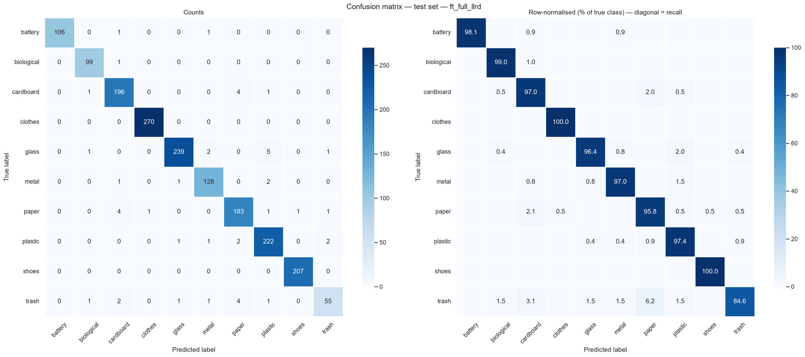

# Garbage Classifier

Ten-class image classification of household waste, built on an ImageNet-pretrained
**RegNetY-1.6GF** backbone fine-tuned in PyTorch. The emphasis is on an evaluation
protocol you can trust: the data is audited, near-duplicates are grouped by perceptual
hash, and the train/validation/test split is stratified **and** group-disjoint, so test
metrics measure generalisation rather than memorised duplicates.

**[Try the live demo →](https://evez12.github.io/Garbage-Classifier/)** — the model runs
in your browser with onnxruntime-web; images are never uploaded.

| | |
|---|---|
| **Test accuracy** | **97.37%** <sub>95% CI 96.63 – 98.06</sub> |
| **Test macro-F1** | **96.77%** <sub>95% CI 95.71 – 97.70</sub> |
| Selected run | `ft_full_llrd` — full fine-tuning with layer-wise LR decay |
| Baseline (linear probe) | 93.38% accuracy / 92.44% macro-F1 |
| Errors | 46 of 1,751 test images |
| Calibration | ECE 0.108 → **0.008** after temperature scaling |
| Inference | 29.8 ms/image (RTX 5070 Laptop, fp32, batch 1) |

---

## Contents

- [Dataset](#dataset)
- [Approach](#approach)
- [Results](#results)
- [Setup](#setup)
- [Training](#training)
- [Inference](#inference)
- [The live demo](#the-live-demo)
- [Repository layout](#repository-layout)
- [Reproducing the exact run](#reproducing-the-exact-run)
- [Licence and credits](#licence-and-credits)

---

## Dataset

[**Garbage Classification v2**](https://www.kaggle.com/datasets/sumn2u/garbage-classification-v2)
by Suman Kunwar — 12,259 photographs across ten waste streams. It is not redistributed
here; download it from Kaggle and lay it out as one directory per class:

```
data/
└── garbage/
    ├── battery/      756 images
    ├── biological/   699
    ├── cardboard/   1411
    ├── clothes/     1892
    ├── glass/       1736
    ├── metal/        930
    ├── paper/       1336
    ├── plastic/     1597
    ├── shoes/       1449
    └── trash/        453
```

Either point `data.root` in [`config.yaml`](config.yaml) at your copy, or pass
`--data-root /path/to/garbage` on the command line.

The classes are moderately imbalanced (max/min ≈ 4.2, `clothes` most frequent, `trash`
least), which is why every selection decision uses **macro-F1** rather than accuracy —
accuracy can look healthy while a minority class is quietly neglected.

## Approach

### Data audit and leakage control

Every file is opened and fully decoded before any modelling, recording its mode, real
format, geometry, an MD5 and a 64-bit perceptual hash. Nothing was corrupt; seven files
had an extension that disagreed with their real format, which is harmless because Pillow
sniffs the actual one.

Web-scraped datasets repeat the same photograph. Images within a Hamming distance of 4
on their perceptual hashes are linked and merged transitively into groups via connected
components on a sparse adjacency matrix. Groups whose members carry *different* labels
are the same picture annotated twice inconsistently, so they are dropped — two images in
this dataset.

A plain stratified random split leaves ≈0.1% of validation and test images with a
near-duplicate somewhere in training. Small, but it inflates the score for free. Applying
`StratifiedGroupKFold` twice produces a split that is stratified by class **and**
disjoint at the duplicate-group level, so the leakage is exactly zero:

| Split | Images | Role |
|-------|-------:|------|
| train | 8,754 | fit the model |
| val   | 1,752 | every decision: epoch, experiment, TTA, temperature, threshold |
| test  | 1,751 | scored once, at the end |

### Two training stages

**Stage 1 — linear probing.** The backbone is frozen and a fresh `Linear(888, 10)` head
trained: 8,890 trainable parameters out of 10.3M. Frozen BatchNorm layers are forced into
`eval()` mode, otherwise `model.train()` keeps updating their running statistics from
small augmented batches and silently shifts the features the head is being fitted on.
This reaches 0.935 validation macro-F1, with train and validation accuracy within ~1.5 pp
of each other — the signature of a *capacity* limit, not variance, which is what makes
fine-tuning worth the compute.

**Stage 2 — fine-tuning.** Four experiments, each starting from the stage-1 checkpoint
(the linear-probe-then-fine-tune recipe, so the head is already fitted when the first
gradients reach the backbone):

| Run | Trainable | Learning rates |
|-----|-----------|----------------|
| `linear_probe` *(baseline)* | `fc` | 1e-3 |
| `ft_block4` | `fc` + `block4` | head 5e-4, block4 1e-4 |
| `ft_block34` | `fc` + `block4` + `block3` | head 5e-4, block4 1e-4, block3 5e-5 |
| `ft_full_llrd` | whole network | layer-wise decay ×0.5 per stage, stem 1e-5 |
| `ft_block34_cw` | as `ft_block34` | as `ft_block34`, plus √ inverse-frequency class weights |

Shared recipe: AdamW (weight decay 0.05, never on BatchNorm or bias), one epoch of linear
warm-up then cosine decay to 1e-6, `CrossEntropyLoss(label_smoothing=0.1)`,
`RandomResizedCrop(0.6–1.0)` + flip + `TrivialAugmentWide` + `RandomErasing`, bf16
autocast, max 20 epochs with early stopping on validation macro-F1.

### Selection, calibration and export

Ranking five runs on a point estimate picks winners by noise. Each run is compared to the
leader with a **paired bootstrap** (2,000 resamples, both models scored on the same
resample so per-image difficulty cancels). Four of the five were statistically tied on
validation macro-F1, and the tie was broken by temperature-scaled validation NLL — a
proper scoring rule, so it rewards honest probabilities rather than a luckier argmax.

Horizontal-flip TTA was measured and **rejected**: −0.13 pp on validation,
`P(Δ ≤ 0) = 0.728`, for double the inference cost. Label smoothing had left the model
under-confident, so a single temperature `T = 0.5847` fitted on validation pulled expected
calibration error from 0.108 to 0.008 without changing a single prediction.

The result is `checkpoints/best_model_bundle.pt`: architecture name, weights, class order,
preprocessing parameters, temperature, the TTA decision and the manual-review threshold.
Inference loads only that file.

## Results

### Headline, test set

| Metric | Selected (`ft_full_llrd`) | 95% CI | Linear probe | Δ |
|--------|-----:|---|-----:|-----:|
| Accuracy | 0.9737 | 0.9663 – 0.9806 | 0.9338 | +4.00 pp |
| Macro-F1 | 0.9677 | 0.9571 – 0.9770 | 0.9244 | +4.32 pp |
| Balanced accuracy | 0.9653 | 0.9538 – 0.9757 | 0.9256 | +3.97 pp |
| Weighted F1 | 0.9736 | 0.9659 – 0.9806 | 0.9335 | +4.01 pp |
| Matthews correlation | 0.9704 | 0.9619 – 0.9781 | 0.9253 | +4.51 pp |
| Top-3 accuracy | 0.9937 | — | 0.9920 | +0.17 pp |
| ROC-AUC (OvR, macro) | 0.9988 | — | 0.9962 | +0.26 pp |
| ECE (temperature-scaled) | 0.0079 | — | 0.0144 | −0.0065 |

The gain over the baseline is statistically significant (McNemar, Holm-adjusted
p = 2.1e-15; 77 images fixed against 7 broken).

### All five runs

| Run | Trainable | Epochs | Train time | Val macro-F1 | Test macro-F1 | Test acc |
|-----|----------:|-------:|-----------:|-------------:|--------------:|---------:|
| `linear_probe` | 8.9K | 15 | — | 0.9351 | 0.9244 | 0.9338 |
| `ft_block4` | 3.9M | 19 | 23.0 min | 0.9614 | 0.9611 | 0.9686 |
| `ft_block34` | 9.9M | 16 | 18.7 min | 0.9647 | 0.9622 | 0.9686 |
| **`ft_full_llrd`** | **10.3M** | **20** | **23.2 min** | **0.9688** | **0.9677** | **0.9737** |
| `ft_block34_cw` | 9.9M | 20 | 20.6 min | 0.9642 | 0.9667 | 0.9732 |

Measured on an RTX 5070 Laptop GPU at batch 64 in bf16.

### Per class, test set

| Class | Images | Precision | Recall | F1 | Missed | False alarms |
|-------|-------:|----------:|-------:|---:|-------:|-------------:|
| trash | 65 | 0.932 | 0.846 | **0.887** | 10 | 4 |
| paper | 191 | 0.948 | 0.958 | 0.953 | 8 | 10 |
| cardboard | 202 | 0.956 | 0.970 | 0.963 | 6 | 9 |
| plastic | 228 | 0.957 | 0.974 | 0.965 | 6 | 10 |
| metal | 132 | 0.962 | 0.970 | 0.966 | 4 | 5 |
| glass | 248 | 0.988 | 0.964 | 0.976 | 9 | 3 |
| biological | 100 | 0.971 | 0.990 | 0.980 | 1 | 3 |
| battery | 108 | 1.000 | 0.981 | 0.991 | 2 | 0 |
| shoes | 207 | 0.995 | 1.000 | 0.998 | 0 | 1 |
| clothes | 270 | 0.996 | 1.000 | 0.998 | 0 | 1 |

`trash` is the weakest stream and the most interesting failure: it is the residual
category, it has the fewest images, and a crushed item of almost anything can land in it.
Its ten misses go to `paper` (4), `cardboard` (2), and one each to `biological`, `metal`,
`glass` and `plastic`. Almost all remaining error is between materials that genuinely look
alike in a photograph — paper against cardboard, plastic against glass.



### Knowing when not to answer

Because the probabilities are calibrated, a confidence threshold turns into a usable
routing rule. Thresholds are chosen on validation and reported on test:

| Target accuracy | Threshold | Test coverage | Accuracy on covered | Sent to review |
|---:|---:|---:|---:|---:|
| 97% | 0.354 | 99.9% | 97.5% | 2 |
| 98% | 0.630 | 98.2% | 98.3% | 31 |
| **99%** | **0.894** | **93.8%** | **99.2%** | **109** |
| 99.5% | 0.974 | 87.3% | 99.7% | 223 |

Routing the least-confident 6% of images to a human buys 99.2% accuracy on the rest. The
0.99 threshold is stored in the bundle as `review_threshold`, and the demo page shows a
"send to manual review" flag when a prediction falls below it.

### Robustness

Against seven corruptions (blur, noise, low light, contrast, JPEG, low resolution,
rotation) the selected model retains **94.0%** of its clean macro-F1, against 92.1% for
the linear probe. The worst case is low resolution at severity 3 (macro-F1 0.704).

## Setup

```bash
git clone https://github.com/evez12/Garbage-Classifier.git
cd Garbage-Classifier

python -m venv .venv
source .venv/bin/activate        # Windows: .venv\Scripts\activate

pip install -r requirements.txt
```

`requirements.txt` pins the exact versions of the reported run but uses the stock PyTorch
wheels, so it installs on CPU-only machines and on CUDA 12.x or 13.x alike. To reproduce
the training environment bit-for-bit (Windows, RTX 50-series, CUDA 13.0 wheels) use
`requirements-cu130.txt` instead. Running the notebook additionally needs a Jupyter front
end (`pip install jupyterlab`); exporting ONNX needs `requirements-onnx.txt`.

## Training

Everything is driven by [`config.yaml`](config.yaml), and any field can be overridden on
the command line, so nothing needs editing to retrain on your own copy of the data.

```bash
# all five runs, then selection, calibration and export
python scripts/train.py --model all

# a single experiment (the linear probe is reused from its checkpoint)
python scripts/train.py --model ft_block34

# several at once
python scripts/train.py --model ft_block4 ft_block34

# your own dataset, on a smaller GPU
python scripts/train.py --model all --data-root /data/garbage --batch-size 32
```

Valid names are `linear_probe`, `ft_block4`, `ft_block34`, `ft_full_llrd`,
`ft_block34_cw`, or `all`. Stage 1 always runs first — it is both the baseline and the
initialisation every fine-tuning run starts from.

Useful flags:

| Flag | Effect |
|------|--------|
| `--data-root PATH` | point at a different copy of the dataset |
| `--batch-size N` | lower it on GPU out-of-memory (32 fits ~5 GB) |
| `--num-workers N` | `0` to debug DataLoader issues |
| `--device cuda:1` / `cpu` | force a device |
| `--amp bf16 \| fp16 \| off` | mixed precision; bf16 needs Ampere or newer |
| `--rebuild-splits` | re-audit the dataset and regenerate `splits/*.csv` |
| `--retrain-linear-probe` | retrain stage 1 (invalidates every fine-tuning run) |
| `--force-retrain` | ignore cached artifacts for the selected runs |
| `--no-evaluate` | stop after training, skip selection and export |

**Caching.** A run is skipped when its artifacts exist, its stored config matches the
current one, **and** the linear-probe checkpoint it started from is unchanged (verified by
MD5). Editing an experiment's hyperparameters therefore invalidates exactly the runs that
depend on it and nothing else. `run.json` is written last and deleted when a run starts,
so an interrupted run is never mistaken for a finished one.

Selection and export can be re-run on their own, from stored logits, in a few seconds:

```bash
python scripts/evaluate.py
```

Training also writes TensorBoard logs (`tensorboard --logdir tensorboard`): per-step loss
and gradient norm, per-epoch metrics, the learning rate of every parameter group,
augmented-batch samples, per-class PR curves and a HPARAMS table across all runs.

## Inference

```bash
python scripts/predict.py photo.jpg
python scripts/predict.py "images/*.jpg" --top-k 5 --json predictions.json
```

```
Model: ft_full_llrd on cuda | TTA off | T = 0.585 | review below 0.894
photo.jpg: glass (0.998)
    glass 0.998, plastic 0.001, metal 0.000
```

Or from Python:

```python
from garbage_classifier.inference import load_bundle, predict_image

net, bundle = load_bundle("checkpoints/best_model_bundle.pt")
result = predict_image("photo.jpg", net, bundle, top_k=3)

print(result.label, result.confidence, result.needs_review)
```

**Pretrained weights.** Checkpoints are too large for the repository, so they are attached
to the [latest release](https://github.com/evez12/Garbage-Classifier/releases/latest).
Download `best_model_bundle.pt` into `checkpoints/` to run inference without training.

## The live demo

[**evez12.github.io/Garbage-Classifier**](https://evez12.github.io/Garbage-Classifier/)

Inference happens **client-side**, with real ONNX weights — not a recorded result. The
bundle is exported to fp32 ONNX (42 MB, opset 18, one self-contained file) and run with
onnxruntime-web; preprocessing, the temperature division and the review threshold are
reproduced in JavaScript from `docs/model/model_meta.json`, exactly as `predict.py` does
them in Python. Nothing is uploaded, and the model is cached after the first visit.

fp32 was chosen over a quantised model deliberately: it reproduces the PyTorch numbers
exactly, so the accuracy quoted on the page is the accuracy the page delivers. The export
is verified both ways — against PyTorch on random input (max absolute difference 4.9e-06)
and end-to-end against the notebook's own stored predictions on ten test images (max
confidence difference 8.1e-06).

onnxruntime-web and both typefaces are vendored into `docs/`, so the page makes no
third-party requests at all. It runs single-threaded because GitHub Pages cannot send the
`COOP`/`COEP` headers that multi-threaded WebAssembly requires; a prediction still takes
roughly 150–350 ms on a laptop.

Rebuild the demo model after retraining with:

```bash
pip install -r requirements-onnx.txt
python scripts/export_onnx.py
```

## Repository layout

```
Garbage-Classifier/
├── notebooks/
│   ├── model_training_notebook.ipynb   full pipeline and analysis (unmodified)
│   └── garbage_dataset.py              import shim so the notebook runs from a clone
├── src/
│   ├── garbage_classifier/
│   │   ├── config.py                   typed configuration loaded from config.yaml
│   │   ├── data.py                     dataset, audit, pHash grouping, splits, transforms
│   │   ├── model.py                    backbone, freezing, optimiser groups, schedules
│   │   ├── metrics.py                  macro-F1, ECE, temperature, bootstrap, McNemar
│   │   ├── training.py                 training and evaluation loops
│   │   ├── experiments.py              run configs, artifacts, caching, registry
│   │   ├── selection.py                model selection, inference recipe, bundle export
│   │   ├── inference.py                bundle loading and single-image prediction
│   │   └── viz.py                      report figures
│   └── garbage_dataset.py              top-level alias for the notebook's import
├── scripts/
│   ├── train.py                        train one run or all of them
│   ├── evaluate.py                     selection, calibration, export, reports
│   ├── predict.py                      classify images with the exported bundle
│   └── export_onnx.py                  build the model the demo page runs
├── docs/                               the GitHub Pages site
│   ├── index.html
│   ├── assets/                         styles, app logic, self-hosted fonts
│   ├── data/metrics.json               every number the page displays
│   ├── figures/                        figures from the notebook
│   ├── model/                          the ONNX model and its metadata
│   ├── samples/                        ten test-split images to try
│   └── vendor/onnxruntime/             vendored onnxruntime-web
├── tests/                              pipeline smoke test
├── config.yaml                         all hyperparameters and paths
├── requirements.txt                    portable pinned environment
├── requirements-cu130.txt              the exact training environment
└── requirements-onnx.txt               ONNX export only
```

Generated directories — `data/`, `splits/`, `checkpoints/`, `experiments/`, `reports/`,
`tensorboard/` — are gitignored and recreated by a run.

### About the notebook

`notebooks/model_training_notebook.ipynb` is the original, **byte-for-byte unmodified**
(SHA-256 `e19487130933f0fcd51846390883fb9258fd6f41d97b662fddb34cbed83a7968`). It contains
analysis the scripts deliberately do not duplicate: Grad-CAM, t-SNE embedding structure,
per-class ROC and PR curves, corruption robustness, latency benchmarking, and the full
statistical comparison.

It resolves paths with `Path.cwd().parent`, so run Jupyter from inside `notebooks/` and
everything lands at the repository root. `notebooks/garbage_dataset.py` is a small shim
that puts `src/` on `sys.path` and re-exports `GarbageDataset`, so the notebook's
`from garbage_dataset import GarbageDataset` works from a fresh clone with no install
step, including in DataLoader worker processes on Windows.

To execute it without touching the original file:

```bash
jupyter nbconvert --execute --to notebook \
  --output-dir /tmp --output run.ipynb \
  notebooks/model_training_notebook.ipynb
```

## Reproducing the exact run

Everything is seeded from `SEED = 11`. With the same dataset, the same seed and the same
library versions, the splits and the reported numbers reproduce.

One caveat, stated in the notebook itself: seeding alone does not make CUDA runs
bit-exact, because cuDNN may select non-deterministic kernels. For strict determinism add
`torch.backends.cudnn.deterministic = True` and `torch.backends.cudnn.benchmark = False`,
at some cost in speed.

The reported run:

| | |
|---|---|
| GPU | NVIDIA GeForce RTX 5070 Laptop GPU (compute capability 12.0) |
| PyTorch | 2.14.0+cu130, bf16 autocast |
| Python | 3.12 |
| Seed | 11 |
| Batch size | 64 |
| Input | 224×224, ImageNet normalisation |
| Total training | ≈86 min across the four fine-tuning runs |

A quick check that the pipeline is wired up correctly, without the dataset:

```bash
pip install pytest
pytest tests/ -v
```

## Licence and credits

Code in this repository is MIT licensed — see [LICENSE](LICENSE).

- **Dataset** — [Garbage Classification v2](https://www.kaggle.com/datasets/sumn2u/garbage-classification-v2)
  by Suman Kunwar, used under its own terms. Not redistributed here.
- **Architecture** — Radosavovic et al., *[Designing Network Design Spaces](https://arxiv.org/abs/2003.13678)*
  (CVPR 2020); weights and the `IMAGENET1K_V2` recipe from
  [torchvision](https://pytorch.org/vision/stable/models.html).
- **Calibration** — Guo et al., *[On Calibration of Modern Neural Networks](https://arxiv.org/abs/1706.04599)* (ICML 2017).
- **Runtime** — [ONNX Runtime Web](https://github.com/microsoft/onnxruntime) (MIT), vendored in `docs/vendor/`.
- **Typefaces** — Bricolage Grotesque and Public Sans, both SIL OFL, self-hosted in `docs/assets/fonts/`.

Built by **Avaz Huseynov**.
